# 💜 DvoreZZKy — Developer Profile

### 💜 Independent Software & Game Developer

**DvoreZZKy (Виктор Дворкин)** — независимый разработчик программного обеспечения и игр.

Специализируюсь на **C# и .NET**, создаю десктопные приложения и игровые проекты. Работаю над собственными идеями, экспериментирую с игровыми движками и постоянно расширяю технический кругозор.

Среди моих проектов — IMoRS, десктопное приложение для работы с интерактивными картами, и Possessive — пиксельный roguelike в Halloween-стилистике.

Финалист VR-хакатона на платформе Varwin. Студент Академии ТОП.

**Открыт к сотрудничеству, разработке интересных продуктов и новым техническим вызовам.**

[🌐 Персональный сайт](https://dvorezzky.github.io) · [💻 GitHub](https://github.com/DvoreZZKy)

---

## 🛠️ Технологии и инструменты

| Направление | Технологии |
|---|---|
| Основной язык | C# |
| Платформа | .NET |
| Игровая разработка | MonoGame, Godot CSharp |
| Разработка приложений | Avalonia UI |
| Архитектура | MVVM |
| Работа с данными | SQLite, Entity Framework Core |
| Веб-разработка | HTML, CSS, JavaScript |
| Дополнительно | C++, Java, Kotlin, Arduino |
| Инструменты | Git, GitHub, Visual Studio, VS Code, Rider |

---

## 🚀 Проекты

### 🗺️ IMoRS — Interactive Map Object Rendering System

**Завершённый проект.**

Десктопное приложение для создания и управления объектами на интерактивной карте.

- 📍 Создание меток с собственными иконками и описаниями.
- 🗺️ Отображение карт на основе OpenStreetMap.
- 💾 Локальное хранение данных в SQLite.
- 🔄 Импорт и экспорт меток.
- 🖥️ Графический интерфейс приложения.

**Стек:** C# · .NET 10 · Avalonia UI · MVVM · EF Core · Mapsui

[**Посмотреть репозиторий →**](https://github.com/DvoreZZKy/IMoRS)

### 🎃 Possessive

**Завершённый игровой проект.**

Possessive — пиксельный Halloween Roguelike, в котором вы играете за маленького паразита-телифона, способного вселяться в тела других существ и управлять ими.

Выживайте среди бесконечных орд монстров, захватывайте их тела и используйте их способности против остальных врагов. Каждый носитель даёт новые возможности, но ничто не длится вечно: рано или поздно придётся искать следующее тело.

**Особенности игры**
- Овладение телами — вселяйтесь в противников и сражайтесь, используя их тела.
- Волны врагов — отбивайтесь от постоянно появляющихся скелетов, тыкв и летучих мышей.
- Битва с боссом — на пятой волне вас ждёт Король Хеллоуина, главное испытание перед бесконечным выживанием.
- Бесконечный режим — после победы над боссом сражение не заканчивается. Проверяйте, сколько сможете продержаться.

**Авторы игры:**
- `SkySoftly` — https://skysoftly.github.io
- `DvoreZZKy` — https://dvorezzky.github.io

---

## 📊 GitHub Statistics

---

## 🌐 Контакты и социальные сети

---

*💜 Turning ideas into projects, one line of code at a time.*

