### 💜 Юный разработчик с реальным опытом

**DvoreZZKy (Дворкин Виктор) — к вашим услугам.**

Пишу на C# — это мой родной язык. Параллельно учусь в Академии ТОП (C#, C++, SQLite, EF Core, Avalonia, Arduino).  
Готовлюсь к ОГЭ по физике и информатике. Финалист VR-хакатона на платформе Varwin.  
Открыт для интересных проектов и заказов!

[🌐 Персональный сайт](https://dvorezzky.github.io) · [💻 Репозитории](https://github.com/DvoreZZKy?tab=repositories) · [📂 Проекты](https://github.com/DvoreZZKy/IMoRS)

---

## 🛠️ Технологии и навыки

| Направление | Технологии |
|---|---|
| Основной язык | C# |
| Платформа | .NET |
| Разработка интерфейсов | Avalonia UI |
| Архитектура | MVVM |
| Работа с данными | Entity Framework Core, SQLite |
| Веб-технологии | JavaScript, HTML, CSS |
| Изучаю | C++, Java, Arduino |
| Инструменты | Git, GitHub, Visual Studio, Visual Studio Code, Rider, CLion |

---

## 🚀 Мой проект

### 🗺️ [IMoRS — Interactive Map Object Rendering System](https://github.com/DvoreZZKy/IMoRS)

Десктопное приложение для создания и управления объектами на интерактивной карте.

- 📍 Создание меток с собственными иконками и описаниями.
- 🗺️ Отображение карты на основе OpenStreetMap.
- 💾 Локальное хранение данных в SQLite.
- 🔄 Импорт и экспорт меток.
- 🖥️ Интерфейс на Avalonia UI.

**Стек:** C# · .NET 10 · Avalonia UI · MVVM · EF Core · Mapsui

[**Посмотреть репозиторий →**](https://github.com/DvoreZZKy/IMoRS)

---

## 📊 Статистика GitHub

---

## 🌐 Контакты

---

*💜 Создаю проекты, изучаю технологии и пишу код.*

